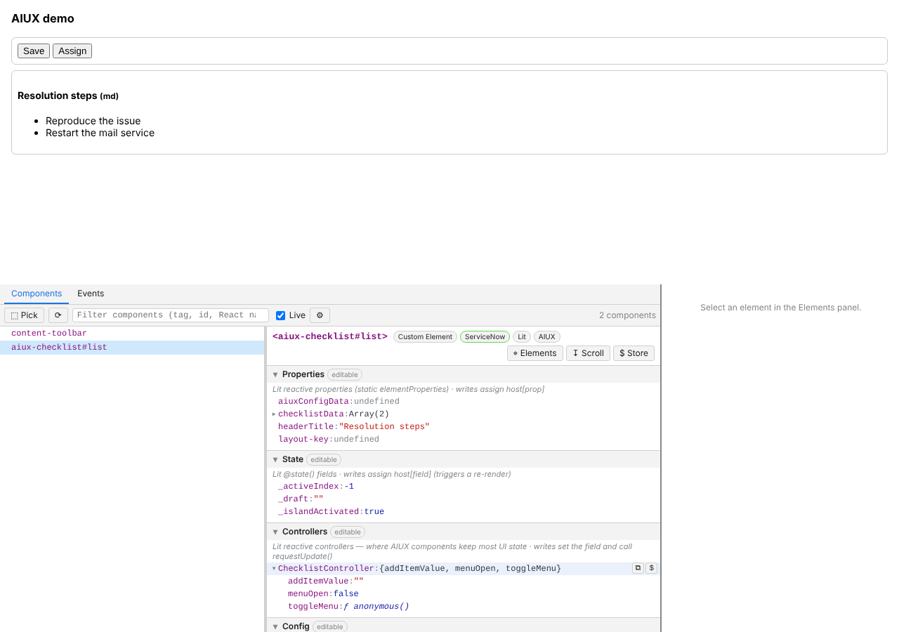
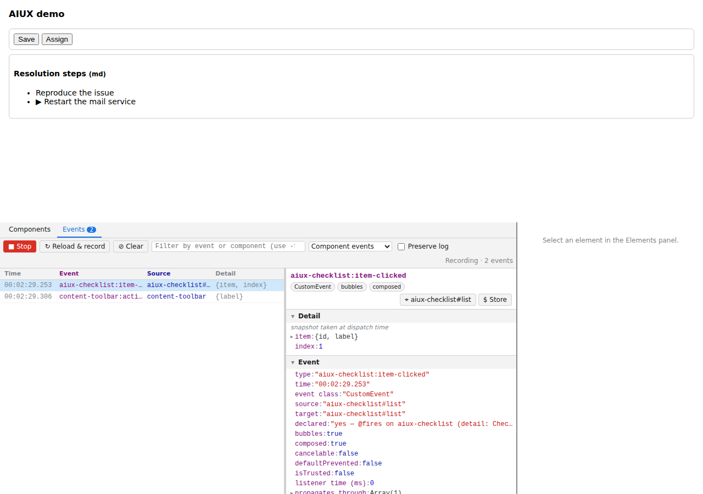

# SN AIUX DevTools

A Chrome DevTools extension for inspecting **ServiceNow AIUX components** ([`@servicenow/aiux`](https://www.npmjs.com/package/@servicenow/aiux)). It works much like the Next Experience Dev Tools: browse the component tree, view and edit each component's **properties** and **state**, see the **events** it declares and the **listeners** registered on it, and watch events in a live **event logger**.



## Features

- **AIUX panel** (a new DevTools tab), with two tabs:
  - **Components**: the component tree and inspector (below).
  - **Events**: a logger of the events components dispatch (see [Events logger](#events-logger)).
- **Components tab**
  - A component tree that walks the light DOM, open **shadow roots** and same-origin **iframes**. AIUX elements are always included, even when their tag doesn't match the tag pattern (e.g. `content-toolbar`).
  - **Pick** mode: click any component in the page to select it (Esc cancels).
  - Hovering a tree row highlights that component in the page. You can filter the tree, and use the arrow keys to move through it.
  - **Live** mode polls the selected component and briefly highlights values that change. Polling pauses while another DevTools panel is in front.
- **AIUX Component sidebar** in the Elements panel shows the nearest component for whatever node you select (`$0`).
- For each component it shows:

  | Section | Source | Editable |
  |---|---|---|
  | **Properties** | AIUX/Lit components: Lit's registry of reactive properties (`static elementProperties`), excluding `@state` fields. Other components: `static properties` / `componentConfig.properties`, `observedAttributes`, and getters/setters on the class | ✅ assigns `host[prop] = value` (nested edits copy the objects along the path, so components that compare by reference see a change) |
  | **State** | AIUX/Lit components: the `@state()` fields. Other components: the host's state object (see [State discovery](#state-discovery)) | ✅ Lit: assigns the field, which re-renders. Others: through `updateState`/`setState`/`patchState` if one is found, otherwise by mutating the object in place |
  | **Controllers** | Lit reactive controllers registered on the component. This is where AIUX components keep most of their UI state: for example, `aiux-checklist`'s `ChecklistController` holds `addItemValue`, `menuOpen` and the drag state. Data fields are listed first, handler functions after. Each controller is named after the component field that holds it (`_ctrl`), because production builds minify class names (`ChecklistController` becomes `E`) but leave field names alone | ✅ sets the field, then calls `requestUpdate()` |
  | **Config** | AIUX `@config` fields (from `configSchema`) | ✅ writes `aiuxConfigData` |
  | **Events** | Events the component **declares** (`@fires` in the `@servicenow/aiux` sources) and events it actually **dispatched** while recording, with counts and last time. Undeclared events are flagged | read-only |
  | **Event listeners** | Listeners registered on the host and its shadow root (from DevTools' `getEventListeners`). Click **{}** on a listener to open its source | read-only |
  | **AIUX** | `AIUXElement` data: `data`, `loaderData`, `serverScriptData`, `loaderScopeKey`, `isEmbedded`, `static capabilities` | ✅ `data` only |
  | **React props / hooks / state** | For AIUX surfaces built with React: the nearest component fiber's props, hook list (State, Memo, Ref, Effect…) and class state | ✅ `useState` hooks (through their dispatcher) and class `setState` |
  | **Attributes** | DOM attributes | ✅ (`null` removes the attribute) |
  | **Host internals** | Every own property of the host element, including non-enumerable and symbol keys | read-only |

- Values are loaded lazily as you expand them. Supported types include objects, arrays, Maps, Sets, Dates, functions, BigInts, Symbols, DOM nodes (click one to jump to it) and circular references.
- Hover over any row to **copy it as JSON** (⧉) or **store it as a console global** (`$aiux1`, `$aiux2`, …). Header buttons reveal the host element in **Elements**, scroll it into view, or store it as a global.
- Light and dark DevTools themes are supported.

## Events logger



AIUX components fire plain DOM `CustomEvent`s from their host element, e.g. `aiux-checklist:item-clicked`, with `bubbles` and `composed` set. While you record, the extension wraps `EventTarget.prototype.dispatchEvent` in the page, including in same-origin iframes. That way it logs every dispatch before listeners run. The wrapper passes every call straight through, and the original is restored when you stop.

- **● Record / ■ Stop.** Starts and stops logging. Recording carries on across navigations.
- **↻ Reload & record.** Reloads the page with the recorder installed before any page script runs. Use it to catch events fired while the app boots.
- **Component events / All dispatched events.** By default the log keeps events dispatched from inside a component, plus app-level `CustomEvent`s on `window`/`document`. *All* also keeps every other `dispatchEvent` call, such as internal event buses and plain DOM events.
- **Filter.** Matches on event name and source component. Prefix a term with `-` to exclude it, e.g. `-focus`.
- **Preserve log.** Keeps the log when the page navigates.
- Selecting an event shows:
  - its **Detail**: a snapshot taken at dispatch time, so later mutations don't change it;
  - its source and target;
  - whether the source component **declares** it via `@fires`;
  - `bubbles`, `composed`, `cancelable`, `defaultPrevented` and `isTrusted`;
  - how long its listeners took;
  - which components it propagates through.
- **⌖ <component>** jumps to the dispatching component in the Components tab, and **$ Store** saves the `Event` object as a console global.

Native browser events, such as a real mouse click, aren't dispatched through `dispatchEvent`, so they aren't logged. The component events those clicks cause are.

### Declared-events catalog

`data/aiux-events.json` maps each component tag to the events it declares (`@fires` JSDoc and public API manifests). It is generated from the `@servicenow/aiux` package. To regenerate it for another version:

```bash
npm install --no-save @servicenow/aiux@<version>
npm run catalog            # node scripts/build-event-catalog.mjs [path/to/@servicenow/aiux]
```

The script reads the package's sources as text and never executes them.

## Install (unpacked)

1. Clone this repo.
2. Open `chrome://extensions`, turn on **Developer mode**, click **Load unpacked**, and choose the repository folder (the one containing `manifest.json`).
3. Open a ServiceNow page (e.g. `/now/...` workspaces or Now Assist / AIUX experiences), open DevTools, and select the **AIUX** tab.

The extension asks for **no permissions**. It only runs code in the page when you open DevTools on that page, via `chrome.devtools.inspectedWindow.eval`. Because of that, it also works on instances with custom domains.

## Editing values

Double-click a value in an *editable* section. Type JSON (`42`, `true`, `"text"`, `{"a":1}`). Anything that isn't valid JSON is stored as a plain string; if it looks like JSON with a typo (it starts with `{`, `[` or `"`), the status bar warns you that this happened. For objects and arrays a multi-line editor opens; press Ctrl/⌘+Enter to apply. Esc cancels.

An edit belongs to the component it was started on. If the selection changes before you commit it, the edit is dropped, never applied to the newly selected component.

## Settings (⚙)

- **Component tag pattern.** A regular expression for which custom elements count as components. Default: `^(now|sn|macroponent|uxf|x|aiux|ai|nas|sys|seismic)-`. `x-` covers scoped-app components such as `x-snc-…`.
- **Show every custom element.** Ignore the pattern and list every tag that contains a hyphen.
- **Detect React components.** Show React component boundaries in the tree, along with their props and hooks.
- **Extra state paths.** Paths on the host element to check first when looking for state, e.g. `__myFramework.state` or `store.getState()` (`()` calls the function). Only used for non-Lit components.

## State discovery

For AIUX components, state is exact: Lit marks every `@state()` field in `elementProperties`, and the **Controllers** section shows the state kept in reactive controllers. Lit stores the controller set under a property whose name is minified in production builds, so the agent finds it by shape instead of by name. For other custom elements there's no standard way to read internal state, so the agent searches the host element for it. The **State** section's note tells you which path was used:

1. Your *extra state paths*.
2. Well-known slots: `state`, `__state`, `_state`, `componentState`, `__component.state`, `__internals.state`, `store.getState()`, `getState()`, …
3. Any own property (including non-enumerable or symbol keys) whose name contains `state`.
4. Any own object property that has a `state`/`_state`/`currentState` object or a `getState()` method.

If nothing is found, open **Host internals** to see where the framework keeps its data, then add that path in Settings.

## Development

```bash
npm install          # Playwright, Lit and React (used by the demo fixtures)
npm test             # agent tests + end-to-end panel/sidebar/events tests in headless Chromium
npm run lint
npm run demo         # http://localhost:5173/test/harness.html?page=aiux
```

The tests use the Chromium that Playwright downloads (`npx playwright install chromium`). To use another Chromium or Chrome binary, set `CHROMIUM_PATH=/path/to/chrome`.

`npm run demo` serves a harness that runs the **real** panel and sidebar against a fixture page, with `chrome.devtools` mocked, so you can work on the UI without a ServiceNow instance.

- `?page=aiux` (`test/fixtures/aiux.html`) uses real Lit components on an `AIUXElement` look-alike. It has properties, `@state`, `@config`, `data` and `capabilities`, and it fires `CustomEvent`s.
- The default page (`test/fixtures/demo.html`) has generic custom elements and a React tree inside a shadow root.

### Verifying against a real AIUX component

The fixtures use a look-alike of AIUX's base class. `npm run verify:aiux` runs the agent against the real thing: it bundles `aiux-checklist` from an installed `@servicenow/aiux`, loads it in headless Chromium, and checks 13 things, among them:

- properties, `@state`, `@config` and controller state are all found;
- a real click is logged and recognised as a declared event;
- edits re-render the component.

It is opt-in because the package and its dependencies are about 1 GB:

```bash
mkdir /tmp/aiux && cd /tmp/aiux && npm init -y
npm install @servicenow/aiux --ignore-scripts
cd -                                  # back to this repo
npm run verify:aiux -- /tmp/aiux
npm run verify:aiux -- /tmp/aiux --minify   # minified, like a production instance build
```

The package's code only runs inside the headless browser, never in Node. Modules that exist only on a ServiceNow instance are replaced with inert stubs. Last run: all 13 checks pass against `@servicenow/aiux@22.67.1`, both as shipped and minified.

Run it again when AIUX updates, together with `npm run catalog`.

### Layout

```
manifest.json          MV3 manifest (devtools_page only, no permissions)
devtools/              registers the AIUX panel and the Elements sidebar
agent/agent.js         page-side agent, injected into the inspected page's main world
data/aiux-events.json  declared events per component, generated from @servicenow/aiux
shared/bridge.js       eval bridge; injects the agent + catalog lazily and after navigation
shared/details.js      inspector UI for components and events (shared by panel and sidebar)
shared/settings.js     settings stored in the extension's localStorage
shared/theme.js        applies and follows the DevTools light/dark theme
panel/panel.js         Components tab (tree + inspector) and tab switching
panel/events.js        Events tab (logger)
sidebar/               Elements-panel sidebar
scripts/               icon and event-catalog generators, real-AIUX verification
test/                  fixture pages, chrome.devtools mock, harness, tests
```

The agent's version must match `manifest.json`'s `version`; the tests check this. Bump both together.

## Limitations

- Not yet tried on a live ServiceNow instance or inside real Chrome DevTools. The agent is verified against a real AIUX component (above); the DevTools-only pieces, `getEventListeners` and `inspectedWindow.reload`, are exercised through a mock.
- Closed shadow roots and cross-origin iframes can't be inspected.
- **Pick** only works in the top document, not inside iframes.
- Arrays and objects show their first 200 entries.
- Events dispatched before you press Record aren't logged. Use **Reload & record** to capture page boot.
- The declared-events catalog reflects the `@servicenow/aiux` version it was generated from (see `source` in `data/aiux-events.json`).
- State edits made without an updater function change the object in place, so the component may not re-render until something else triggers a render.
- `useReducer` state is read-only, because writing it would require sending a reducer action.
